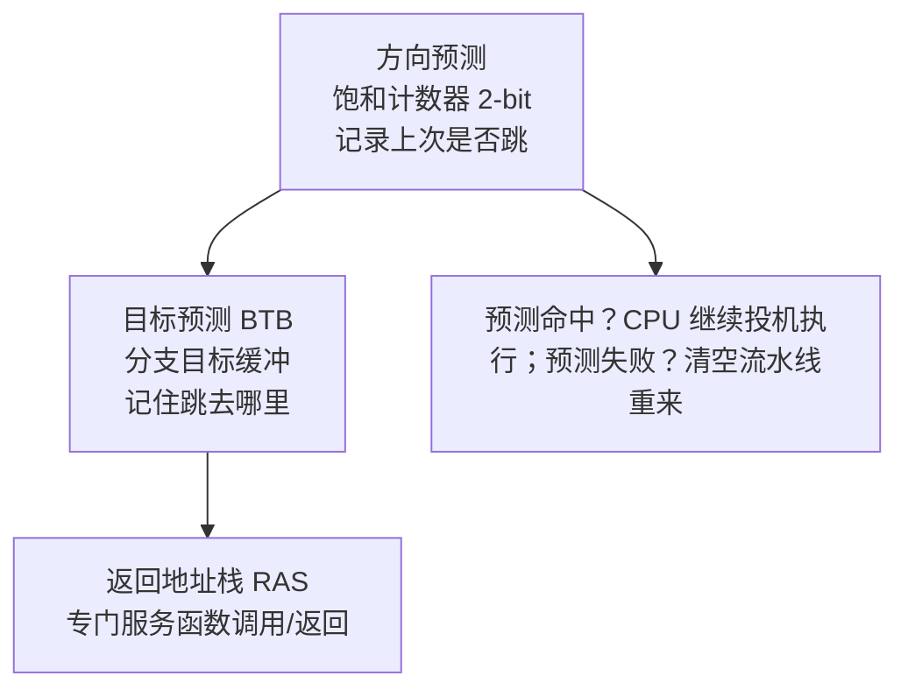
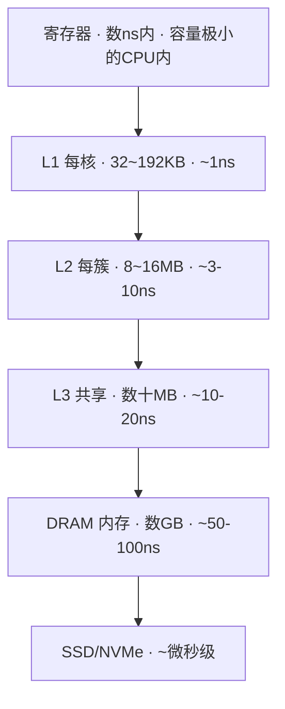
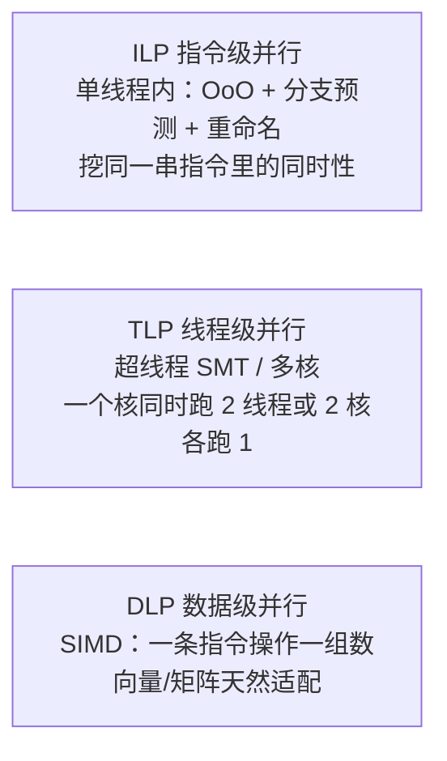

# 芯片架构内功 · 微架构通用深潜（①）

> **定位**：本课「纵向架构内功轴」的第一块，是整个深潜系列的 **基石**。  
> 它回答的是「芯片**内部**到底怎么干活」——这是你读懂任何评测、任何规格表的底层语言。  
> **配套**：横向博览总纲在 [`../芯片架构横向博览知识系统.md`](../芯片架构横向博览知识系统.md)；本块可视化在同级 `流水线动画.html` 与 `MESI缓存一致性动画.html`。  
> **与 OS 课分工**：OS 课讲「芯片 → 这台 Mac 的每一层**系统行为**」（启动链 / 内存管理 / 调度，处在**系统接口层**）；本课讲「芯片**自己内部**怎么干活」（流水线 / 缓存 / 执行单元，处在**硅内部层**）。一层在接口、一层在硅里，互补不重叠。
>
> **怎么读这篇**：黑字是「精确版」（术语准、可当字典查）；每个 **人话** 框是「大白话版」——打比方 + 用你这台 M5 Pro、你熟悉的 Windows/macOS 体感解释。赶时间先看人话框，想较真再看黑字。

---

## 0. 为什么先学这块（而非直接看核/GPU）

横向博览里你已经知道：大小核、UMA、制程代号、读规格表看什么。但那些结论的**原因**都在硅里：

- 为什么「看内存带宽」比「看频率」重要？→ 因为集显/NPU 被内存墙卡住（见 §4 缓存与 §6 功耗）。
- 为什么大小核能省电？→ 因为动态功耗和电压平方成正比，小核可以跑在更低电压（见 §6）。
- 为什么分支预测失误会让程序变慢？→ 因为要**清空整条流水线**（见 §3 + 流水线动画）。

学完本块，你回看横向博览的 1.4 / 1.5 会瞬间「通」——那不是新结论，是旧结论的底层原因。

> **人话**：你现在看评测，会看到一堆结论——「这 U 单核强」「那 U 看内存带宽」。但「为啥强」「为啥要看带宽」，评测不会讲。答案全在硅里，藏在本块。学完你回头看之前横向课那些结论，会像「哦——原来是因为这个」。不是新知识，是旧结论的底层原因。就像你早就知道「Mac 比旧 Windows 本省电」，现在要搞懂「到底是啥让它省电」。

---

## 1. 一条指令的一生（指令生命周期）

CPU 不是「一条指令跑完再跑下一条」，而是把一条指令拆成多个阶段，**多条指令在不同阶段重叠前进**——这就是流水线（pipeline）。经典 5 级：


- **超标量（Superscalar）**：每周期不止发 1 条，而是 2~6 条（现代大核宽发射）。你 M5 Pro 的 P 核就是宽发射。
- **乱序执行（Out-of-Order, OoO）**：指令**按程序序取指/译码，但哪个先执行完哪个先退休**。目的是别让一条慢指令（比如缓存未命中）堵死后面快指令。
- **寄存器重命名（Register Renaming）**：程序员看到的「寄存器」是逻辑名（如 x86 的 RAX、ARM 的 X0），硬件另有更大的**物理寄存器堆**，把不同指令的同名逻辑寄存器映射到不同物理寄存器——从而消除 WAR/WAW 假相关（见 §2）。
- **现代深度**：教学用 5 级，真实大核是 **14~20 级深流水线**（更深=更高频率，但分支失误代价更大）。

> **人话**：
>
> - **流水线**本身就像**工厂装配线**。造车不是造完一辆再造下一辆，而是车架、发动机、座椅同时在不同的工位上流动——第一辆到装座椅时，第二辆已经在装发动机了。CPU 也一样：一条指令拆成「取指/译码/执行…」，多条指令在不同阶段重叠前进。你那台旧的 Windows 本单核慢，很大程度是流水线浅、塞不满。
> - **超标量**＝装配线一次过 2~6 件，不是一件。你 M5 的 P 核就是「宽车道」。
> - **乱序执行**＝你排队买咖啡，前面人翻包找手机付款卡住了，你后面的人其实可以先付。CPU 也这样：一条慢指令（比如要去内存拿数据、得等）不该堵死后面快指令，谁先算完谁先走。
> - **寄存器重命名**：俩人都要用「3 号柜」，但其实柜子有一整面墙。硬件把「逻辑上的 3 号」临时指到不同的物理柜子，让你俩互不干扰同时放东西。这就消掉了「你放完我才放 / 你放时我别读」这种假冲突。
> - **深度 14~20 级**：工位越多，时钟能跑越高（车能开更快）；但前面有人摔倒（分支猜错），后面整条线都得重来，代价更大。

> **动手（你的 M5 Pro）**：看指令集与 SIMD 支持——
>
> ```bash
> sysctl hw.optional.neon hw.optional.arm.AdvSIMD hw.optional.arm.FEAT_FP16
> # → 均为 1：ARM NEON / AdvSIMD / FP16 就绪（数据级并行 DLP 的硬件基础，见 §5）
> ```

> **人话（动手这句）**：这条命令就是在问你这台 Mac：「你支不支持一次性算一组数（SIMD）？」回答全是 1（支持）。这跟你 Windows 上 CPU-Z 里看到的「指令集：SSE4.2 / AVX2」是一个意思，只是 ARM 这边叫 NEON。

---

## 2. 流水线三大冒险（为什么不简单）

流水线想「满负荷」很难，因为指令之间会互相打架，叫**冒险（hazard）**：

| 冒险       | 是什么                           | 怎么解决                                                            |
| -------- | ----------------------------- | --------------------------------------------------------------- |
| **结构冒险** | 两个阶段抢同一资源（如单端口访存）             | 增加硬件端口 / 流水级错开                                                  |
| **数据冒险** | 后一条指令要用前一条还没算完的结果（RAW 真相关最常见） | **转发/旁路（bypass/forwarding）** 把结果直接从 EX 送回；实在来不及就**插入气泡（stall）** |
| **控制冒险** | 碰到分支（if/循环），下一条该取哪个地址要等分支结果   | **分支预测**（见 §3）——这是现代性能的最大杠杆之一                                   |

- **RAW / WAR / WAW**：三种数据相关。RAW（读在写前，真依赖）靠转发；WAR/WAW（写读/写写顺序）靠**寄存器重命名**消解，让它们能乱序、并行执行而不冲突。
- 一个 `stall` 就是流水线空转一个周期——看起来小事，但分支密集的代码里累积起来就是性能腰斩。

> **人话**：
>
> - **冒险**说白了就&#x662F;**「卡住 / 打架」**。流水线想一直满负荷很难，因为前后指令会互相挡道。
> - **结构冒险**＝只有一个洗手间，两个人不能同时上。解决办法：多修几个（多端口），或错开时间用。
> - **数据冒险**＝你等快递，快递还没到你就没法拆箱。后一条指令要用前一条还没算完的结果。解法有两个：① **转发**——产线上一道工序刚做出来的东西，直接递给下一道，不用先回仓库（快）；② 实在赶不上，**插气泡**——流水线空转一拍，等结果。
> - **控制冒险**＝你走到岔路口，得看路牌才知道往哪走；但 CPU 不等，先猜一个方向走（这就是 §3 的分支预测）。
> - 一个 **stall（气泡）** 就是流水线白空转一拍。单看没事，但分支密的程序里，这种「白等」累积起来，性能直接腰斩。

---

## 3. 分支预测（性能命门）

**为什么分支这么贵**：现代代码分支密度很高（每 5~10 条指令一个分支）。分支结果出来前，CPU 不知道下一条取哪——**只能猜**。猜错就要**清空已经塞进流水线的后续指令（flush）**，惩罚 = 流水线深度（十几到二十几周期）。

现代分支预测器由三部分组成：



- **2-bit 饱和计数器**：对每条分支记一个状态机，连对连错来平滑判断「这次跳不跳」——比单次记忆稳。
- **BTB（Branch Target Buffer）**：分支的「跳去哪」也要预测，否则取指阶段就卡住。
- **RAS（Return Address Stack）**：函数 `call/return` 极有规律，专用栈预测返回地址，命中率近 100%。
- **进阶**：服务端用 **TAGE**（用历史长度分级的预测表）、甚至**感知机/神经预测器**（Intel 一些核、AMD 分支预测里用到机器学习思路）。
- **投机执行（Speculative Execution）**：预测后 CPU **真的提前执行**分支里的指令（赌对了就白赚，赌错了丢弃）。这恰恰是 **Spectre/Meltdown 侧信道攻击的温床**——见 §4 末尾与深潜⑤安全微架构。

> **人话**：
>
> - 现代代码平均每 5~10 条就一个分支（if / 循环），岔路口超多。分支结果出来前，CPU 不知道下一条该取哪——**只能猜**。猜错就要把已经塞进流水线的后续指令**全清空重来**，罚十几到二十几拍。所以「猜得准不准」直接决定快慢。这就像你每天下班走同一条路，前面该左转（**方向预测**）、左转后到哪栋楼（**目标预测 BTB**）、回家时原路返回点（**返回栈 RAS**）——记住这些，你闭眼都不会走错。
> - **投机执行**：猜了就真干，赌对了白赚，赌错了把干了一半的活扔掉重来。问题恰恰是：扔掉归扔掉，但「干的过程中顺手瞥到的东西」没擦干净——这正是 Spectre/Meltdown 漏洞的温床（深潜⑤会专门讲）。

> **可视化**：打开 `流水线动画.html`，点「来个 if 判断」看预测猜中 vs 猜错时流水线如何流动 / 清空。这是「看不见的过程」变成肉眼可见的最佳例子。

---

## 4. 缓存（内存墙的另一面）

CPU 算得越快，越被「数据在哪」卡住。寄存器到 DRAM 延迟差 **百倍**，于是插多层缓存：



- **Cache Line（缓存行）**：缓存和内存之间搬运的**最小单位**，通常 64 字节。一次 miss 就搬一整行——所以「连续访问」远快于「跳跃访问」。
- **组相联（Set Associativity）**：每行该放哪组（直接映射 / 组相联 / 全相联）决定冲突概率。
- **写策略**：写回（write-back，脏了才写回内存）vs 写穿透（write-through，每次都写）；现代多用写回 + 脏位。
- **多核一致性 —— MESI 协议**（本块最该动手看的部分）：
  - 四个状态：**M**odified（改过，独占且脏）/ **E**xclusive（独占，干净）/ **S**hared（多核共享，干净）/ **I**nvalid（无效）。
  - 靠**总线事务**协调：BusRd（别人要读）、BusRdX/BusUpgr（别人要写→把我的副本作废）。
  - 典型场景：核0 写了某行→变 M；核1 想读→总线通知核0 写回并降级为 S；核1 拿到 S；核1 要写→发 BusUpgr 把核0 那行作废→自己变 M。
  - **伪共享（False Sharing）**：两个核各改**不同变量**，却不幸落在**同一缓存行**→ 这行在两核间反复 M/S 颠簸，性能暴降。这正好呼应 OS 课「缓存行对齐 / 数据结构 padding」的工程手法——但 OS 课在系统侧讲，本课在硬件侧讲根因。

> **人话**：
>
> - **为什么要有缓存**：CPU 算得飞快，但数据在内存里「离得远」，拿一次要等百倍时间。就像你干活，工具在手边（寄存器）秒取，去库房（内存 DRAM）要走半天。中间加几层「中转架」（L1/L2/L3），近的先用，不够再去远的地方拿。
> - **缓存行（64 字节）**：搬数据的最小一「板车」，一次没命中就整板车搬回来。所以「挨着拿」（连续访问）远快于「跳着拿」——就像你从货架取东西，顺手把旁边一格也拿了，比每次只拿一个、来回跑快得多。
> - **组相联**：这板货该放哪排货架？规则越死（直接映射）容易俩货抢一格；规则越松（全相联）不撞但找起来慢。取个折中就是「组相联」。
> - **MESI**：多核各有一份缓存副本，得保证不「各说各话」。四个状态像：这货**归我独用且我改过(M)** / **归我独用没改(E)** / **大家都有份(S)** / **我的作废了(I)**。靠「广播」协调：谁要写，喊一声让别人的那份作废。
> - **伪共享**＝俩核各改不同变量，却不幸挤在同一板车（缓存行）里——这板车在两核间反复「作废-重拿」颠簸，性能暴降。就像俩人改同一张表的不同格，但系统只认「整行锁」，白白打架。这正好呼应 OS 课里说的「缓存行对齐 / padding」。

> **你的 M5 Pro 实测缓存拓扑**（来自本机 `sysctl`）：
>
> | 核心类型                 | 数量 | L1I    | L1D    | 共享 L2           |
> | -------------------- | -- | ------ | ------ | --------------- |
> | **P 核（Performance）** | 10 | 128 KB | 64 KB  | 每 5 核 **8 MB**  |
> | **E 核（Efficiency）**  | 5  | 192 KB | 128 KB | 每 5 核 **16 MB** |
>
> 注意 E 核反而配了更大的 L1/L2——因为小核没有大乱序窗口兜底，更靠「大缓存」掩盖访存延迟。这正是 §6 功耗取舍的镜像。

> **人话（这张表）**：你这台 M5 有两类核。**P 核**是干重活的（10 个），**E 核**是省电打杂的（5 个）。注意一个反直觉的点：E 核反而配了**更大**的 L1/L2 缓存。原因很实在——小核没有大乱序窗口兜底（§1 说的「谁先算完谁先走」能力弱），所以它更靠「大缓存」把数据提前备好，来掩盖去内存拿数据的慢。这跟 §6 说的「小核省电」是一体两面。

> **可视化**：打开 `MESI缓存一致性动画.html`，点两核的读/写按钮，看状态如何在 M/E/S/I 间跳、总线事务如何广播。

---

## 5. 三类并行（ILP / TLP / DLP）

同一颗芯片挖性能，靠三条不同的「并行」路子：



- **ILP（Instruction-Level Parallelism）**：靠乱序执行 + 分支预测 + 重命名，在**单线程**里找能并行的指令。天花板受「真实数据依赖」限制——不是想挖就能挖。
- **TLP（Thread-Level Parallelism）**：SMT（超线程，Intel 叫 Hyper-Threading）让**一个物理核**逻辑上跑 2 线程，共享执行单元但各有寄存器/重命名表；或者干脆多核。你的 M5 Pro 没有 SMT（ARM 传统如此），靠物理多核做 TLP。
- **DLP（Data-Level Parallelism）**：**SIMD（单指令多数据）**——一条指令同时对 4/8/16 个数做同样运算。x86 的 SSE/AVX/**AVX-512**（512 位宽），ARM 的 **NEON**（128 位）/ **SVE**（宽度可伸缩 128~2048），RISC-V 的 V 扩展。多媒体、科学计算、AI 推理的加速全靠它——你 M5 Pro 的 `neon=1` 就是 DLP 的硬件。

> **人话**：
>
> - **ILP（指令级并行）**：在**单线程**内部找能同时干的指令（靠 §1 的乱序+预测+重命名）。但受「真实依赖」天花板限制——比如 `b = a+1; c = b+1`，c 必须等 b，这种串行链条想并行也没辙。
> - **TLP（线程级并行）**：Intel 的**超线程（Hyper-Threading）**&#x5C31;是让一个物理核逻辑上同时跑 2 个线程，共享执行单元、各有一套寄存器。或者干脆多核。你 M5 没超线程（ARM 传统如此），靠物理多核硬堆。
> - **DLP（数据级并行）**：**SIMD**＝一条指令同时对一组数算同样的事。最直观的例子：循环「对数组每个元素加 1」——与其一个一个加，不如一次加一整排。你 M5 的 `neon=1` 就是干这个的硬件。多媒体、AI 推理的加速全靠它。
>
> 工程直觉一句话：循环里「对一堆数做同样运算」→ DLP 最爱（SIMD）；「很多互相独立的任务」→ TLP / 多核；「单条串行依赖链」→ 只能靠 ILP 和更高的单核频率。

---

## 6. 功耗物理（为什么小核省电、为什么 nm 重要）

性能不是免费午餐，代价是**功耗与发热**。两块基本功：

- **动态功耗**：`P_dynamic = α · C · V² · f`
  - `C` 电容、`f` 频率、`V` 电压、**V 是平方**。
  - 推论：**降电压比降频率划算得多**。同性能下，降电压省电是平方级，降频率只是线性——这就是 DVFS（动态调频调压）和小核存在的物理根因：小核用更低电压跑，省电是平方级。
  - 再呼应横向博览 1.4：大小核不是「大核偷懒」，是**在电压-频率曲线上选不同工作点**来匹配负载。
- **静态漏电（Leakage）**：晶体管关断时仍漏电流，且**工艺越先进（尺寸越小）漏电越严重**。这带来两个现象：
  - **暗硅（Dark Silicon）**：芯片上晶体管太多，散热不允许全部同时满负荷——相当一部分得「关着」。芯片设计变成「在功耗预算内决定哪些模块亮着」。
  - 频率/电压不能无限堆：越先进节点，漏电占比越高，单纯提频的性价比暴跌。

> **人话**：
>
> - **动态功耗公式**，核心就一句：**功耗 ≈ 电容 × 电压² × 频率**。重点在**电压是平方**！所以同性能下，降电压比降频率省电得多——降压是平方级省，降频只是线性省。这就是小核为啥省电：它跑在**更低电压点**。也解释了大小核不是「大核偷懒」，是「在电压-频率曲线上选不同工作点」来匹配负载（呼应横向课 1.4）。
> - **漏电 / 暗硅**：晶体管关了也漏电流，而且做得越小漏得越凶。结果：芯片上晶体管多到散热不允许全开，一部分得关着——叫「暗硅」。像**城市限电**：不能所有空调同时开，得轮流。越先进的工艺，漏电占比越高，单纯堆频率的性价比暴跌。

> **动手（你的 M5 Pro）**：看两类核实时功耗与频率——
>
> ```bash
> sudo powermetrics --samplers smc -n 1 | grep -iE "CPU Power|GPU Power|E-Cluster|Performance"
> ```
>
> 你会直观看到：轻负载时 E 核（低电压点）扛着，P 核几乎休眠；重负载时 P 核拉起、整机电功率跳升——这就是 §6 公式在真机上的样子。

> **人话（动手这句）**：这条命令让你**亲眼看见**上面那套功耗理论。轻负载时，是 E 核（低电压、省电）在扛，P 核基本睡大觉；一压重活，P 核醒来、整机电功率明显跳升。你在 Windows 上用 HWiNFO / 任务管理器看「功耗」「频率」也是同一回事，只是 Mac 这边用 `powermetrics` 看。

---

## 7. 动手实验（把内功变成你亲眼看到的数字）

> 全部只读 / 本地，放心跑。

**实验 A · 看缓存拓扑（已实测，见 §4 表）**

```bash
sysctl hw.perflevel0.l1dcachesize hw.perflevel0.l2cachesize \
       hw.perflevel1.l1dcachesize hw.perflevel1.l2cachesize
# perflevel0 = E 核, perflevel1 = P 核（macOS 对大小核分两个 perf level 暴露）
```

> 注：Apple Silicon 的精细缓存拓扑不如 x86 在 `cpuid` 里暴露得全；上面这组 `perflevel` 键是 macOS 上最直观的口径。

> **人话（实验 A）**：这条命令就是把 §4 那张「M5 缓存表」直接问机器要出来。注意 macOS 把大小核分成了 `perflevel0 / perflevel1` 两个档来报——Windows 上你得用 CPU-Z 或 `wmic` 看，但道理一样：看清「每类核自己有多大的 L1/L2」。

**实验 B · 看真实功耗（§6）**

```bash
sudo powermetrics --samplers smc -n 1 | grep -iE "Cluster|CPU Power"
```

**实验 C · 进阶——用性能计数器看「内功指标」**

- macOS 上可用 **Instruments → Counters** 模板，或 `sudo powermetrics` 里已含部分 PMC。
- 想看**分支预测失误率 / 缓存命中率**这类微架构事件，专业路径是 `pmc`/`perf` 类工具或 Instruments 的「Counters」——它们直接读 CPU 内部的性能监控计数器，是验证 §2/§3/§4 理论的硬证据。
- *Windows 对照*：Win 下用 **perfmon / Windows Performance Recorder (WPR)** 看分支误预测/缓存命中；Linux 下 `perf stat` 一行出齐：`perf stat -e branch-misses,cache-misses,cache-references ./your_program`。

> **人话（实验 C）**：§2/§3/§4 讲的「分支猜错」「缓存命中」不是玄学，CPU 内部有专门的计数器在数。想看硬证据，Mac 上用 Instruments 的 Counters，Linux 上一条 `perf stat` 就把「分支失误几次、缓存miss几次」全打出来。Windows 上用性能监视器（perfmon）或 WPR。这是把「内功」变成你亲眼看到的数字的进阶玩法。

**实验 D · 缓存效应 mini 实验（cache blocking）**

- 写一个大矩阵乘法，对比「直接三层嵌套」vs「分块（tile）到 L1/L2 大小」：后者缓存命中率飙升、耗时会明显下降——这就是 §4 缓存行 + §5 DLP 的联合实战。
- 哪怕用 Python/NumPy 看 `np.dot` 与大循环的差异，也能感受到「数据局部性」的威力（NumPy 底层本就是分块 + SIMD）。

> **人话（实验 D）**：§4 说「连续访问远快于跳着访问」，这条让你亲手验证。写个大矩阵乘法，一种是傻乎乎三层循环瞎算，一种是切成小块（块大小刚好塞进 L1/L2）再算——后者缓存命中率飙升，耗时会明显掉。哪怕你用 Python 的 `np.dot` 对比手写大循环，也能感到「数据局部性」的威力（NumPy 底层本就是分块 + SIMD）。

---

## 8. 本块小结 + 去哪

- 你已掌握：**指令生命周期、三大冒险、分支预测（投机执行）、缓存层级与 MESI、三类并行、功耗平方律**。这是读一切评测/规格表的底层语言。
- **回看横向博览**：1.4 大小核的功耗逻辑（§6）、1.5 为什么看带宽/缓存（§4/§5）——现在都是「原因」而非「结论」。
- **联动 OS 课**：OS 课的页缓存 / 内存管理 / 调度，在硬件侧就是本块的缓存层级 / MESI / 多核并行。两层合起来，你才真正理解「为什么系统要这么设计」。
- **下一跳（深潜②）**：计算单元架构——把本块的「通用核」换成 CPU 大核 vs 小核的微架构差异、GPU 的 SIMT/warp/张量核、NPU 的脉动阵列。

> **人话（收个尾）**：到这儿，你已经拿到了「读懂任何评测和规格表」的底层语言。回头看之前横向课那些结论（大小核为啥省电、为啥看带宽），现在你脑子里装的是**原因**而不是**结论**了。再往深，下一块（② 计算单元）会把本块的「通用核」拆开：CPU 大核/小核差在哪、GPU 为啥适合并行、NPU 怎么加速 AI。

---

## 附录 · 本块可视化索引

| 文件                                     | 形式        | 对应章节                  |
| -------------------------------------- | --------- | --------------------- |
| [`流水线动画.html`](流水线动画.html)             | 交互（零依赖离线） | §1–§3 流水线 / 冒险 / 分支预测 |
| [`MESI缓存一致性动画.html`](MESI缓存一致性动画.html) | 交互（零依赖离线） | §4 多核缓存一致性            |

> 两个 HTML 都是纯前端、离线可跑、深色主题，符合你「可编辑模板 / 自己能改数据」的偏好——想调参数直接改源码即可。
>
> **人话（附录）**：这俩动画就是让你「看见」本块最抽象的两件事——指令怎么在流水线里流动、多核缓存怎么达成一致。打开点几下比看文字快十倍。
